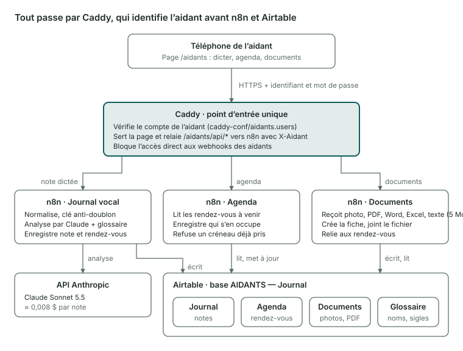

# Journal des parents

Outil pour des aidants familiaux : ils dictent ou écrivent une note depuis leur téléphone, un workflow n8n la corrige avec Claude, la classe et l'enregistre dans un journal Airtable, avec les rendez-vous qu'elle contient. Une page protégée affiche l'agenda, permet de se positionner sur un rendez-vous et de joindre des documents.



Chemin d'une note : `Téléphone → Caddy (compte) → n8n → Claude → Airtable`.

## Contenu du dépôt

| Chemin | Rôle |
|---|---|
| `site/index.html` | Page des aidants : dicter, agenda, documents, menu Modifier / Supprimer à l'appui long |
| `scripts/aidant-ajouter.sh` | Gestion des comptes et des rôles, miroir dans Airtable |
| `caddy/Caddyfile.example` | Caddyfile d'exemple, avec `<DOMAINE>` et `<TOKEN>` à remplacer |
| `docs/architecture.svg` | Schéma fonctionnel |

Les workflows n8n, les identifiants, les jetons et les données de la famille ne sont pas dans ce dépôt.

## Repères

| Élément | Valeur |
|---|---|
| Serveur | VPS Linux, Docker Compose dans `/opt/n8n` : `n8n` et `caddy` |
| Adresse | `https://<DOMAINE>/aidants/` |
| Page | `/opt/n8n/aidants-site/index.html`, servie par Caddy |
| Comptes | `caddy-conf/aidants.users` (tous), `aidants.editeurs` (éditeurs) |
| Workflows n8n | Journal vocal, Agenda, Documents |
| Airtable | Journal, Agenda, Documents, Aidants, Glossaire |
| Modèle | Claude, appelé seulement par le workflow Journal vocal |
| Accès direct aux webhooks | Bloqué (404) par Caddy ; seul `/aidants/api/*` est joignable, après authentification |

## Commandes courantes

```bash
# état et journaux
cd /opt/n8n && docker compose ps
docker logs --tail 50 n8n-caddy-1
docker logs --tail 50 n8n-n8n-1

# redémarrer
docker compose restart caddy
docker compose restart n8n

# valider le Caddyfile avant de redémarrer
cp Caddyfile Caddyfile.bak-$(date +%F-%H%M)
docker compose exec caddy caddy validate --config /etc/caddy/Caddyfile
```

Le Caddyfile est monté seul : un éditeur de texte remplace le fichier, et le conteneur voit l'ancien tant que Caddy n'a pas redémarré. Après toute modification, `docker compose restart caddy`, puis valider.

## Comptes et rôles

- **Standard** : dicter, consulter l'agenda, joindre des documents, modifier ou supprimer les rendez-vous issus de ses propres notes.
- **Éditeur** : en plus, modifier ou supprimer tous les rendez-vous.

Le rôle de chaque compte apparaît dans la table Airtable `Aidants`. Le droit est contrôlé par Caddy et par n8n, jamais par la page.

```bash
export WEBHOOK_TOKEN=<TOKEN>          # préfixe secret des webhooks n8n
./aidant-ajouter.sh                    # ajout, ou nouveau mot de passe (demande le rôle)
./aidant-ajouter.sh --editeur Prenom   # tous les rendez-vous
./aidant-ajouter.sh --standard Prenom  # seulement les siens
./aidant-ajouter.sh --retirer Prenom   # supprime le compte
./aidant-ajouter.sh --liste            # comptes et rôles
./aidant-ajouter.sh --synchro          # renvoie les rôles vers Airtable
```

Le prénom sert d'identifiant : lettres et tirets, sans accent ni espace.

## Déployer une nouvelle version de la page

```bash
# poste local
scp site/index.html root@<IP_VPS>:/tmp/index.html
# vps
mv /tmp/index.html /opt/n8n/aidants-site/index.html && chmod 644 /opt/n8n/aidants-site/index.html
```

Aucun redémarrage : recharger la page suffit.

## Dépannage express

| Symptôme | Piste |
|---|---|
| Une note part en version brute | Crédits de l'API Claude épuisés, ou erreur du modèle : voir l'exécution dans n8n |
| Modification d'un workflow sans effet | Brouillon non publié : *Publish* |
| Page muette ou erreur 502 | Caddy arrêté ou Caddyfile invalide : logs, puis restaurer la sauvegarde `.bak` |
| Rendez-vous supprimé mais toujours affiché | Journal et Agenda sont deux tables : supprimer dans les deux, ou passer le statut à « Annulé » |
| Pas de menu Modifier / Supprimer | Rendez-vous d'un autre aidant ou saisi à la main : réservé aux éditeurs |
| Chrome redemande sans cesse la connexion | Supprimer l'ancienne entrée du gestionnaire de mots de passe, fermer Chrome |
